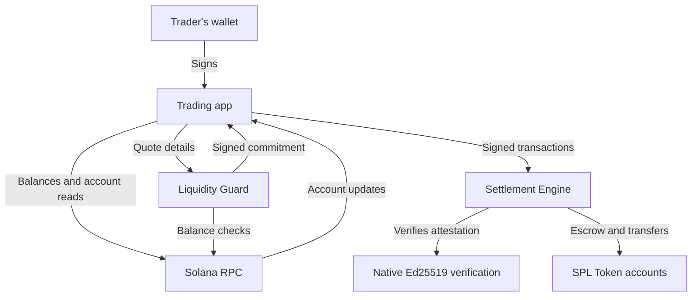

# Architecture and trust boundaries

[Back to the project overview](../README.md) · [Protocol lifecycle](protocol.md)

## System structure

The trading app builds transactions and presents on-chain state. The Settlement Engine enforces the rules. The Liquidity Guard performs a separate off-chain check before a quote is accepted.

Onboarding is a separate path: the website calls the waitlist service, email activation triggers a distribution job, and the worker transfers devnet uUSDC to the registered wallet. The trading program does not call the waitlist service to approve each trade.

## On-chain responsibilities

The [Settlement Engine](https://github.com/unleaktrade/settlement-engine/tree/main/programs/settlement-engine/src) owns the lifecycle and accounting. Its main account types are:

| Account | Responsibility |
| --- | --- |
| `Config` | Deployment configuration: admin, bond-token mint, treasury, Guard key, and facilitator fee share |
| `Rfq` | Maker, pair, amounts, minimum quote, bonds, fees, phase durations, counters, and current state |
| `Quote` | One taker's commitment, reveal, selection, and refund status for an RFQ |
| `CommitGuard` | A global record preventing reuse of the same commitment hash within the program |
| `Settlement` | Selected participants and economic terms, plus settlement progress |
| `SlashedBondsTracker` | Bond seizure accounting and resolution status |
| `FeesTracker` | Treasury fee accounting in the quote token |
| `FacilitatorRewardTracker` | Accounting for a facilitator's reward claim |

An RFQ is derived from its maker and UUID. A Quote is derived from the RFQ and taker, giving one quote account per taker per RFQ. Relevant configuration values are copied into the RFQ when initialized, including its Guard key, bond-token mint, treasury, and facilitator fee share.

The program uses classic SPL Token accounts and transfers. No AMM pool, public order book, price oracle, or automatic best-price selection is required for settlement. The maker chooses among valid revealed offers.

## Commitment and attestation

The app, Guard, and engine agree on this ordered 178-byte preimage:

| Field | Encoding | Bytes |
| --- | --- | ---: |
| Salt | Raw bytes | 64 |
| RFQ address | Public key | 32 |
| Taker address | Public key | 32 |
| Quote-token mint | Public key | 32 |
| Quote amount | Unsigned integer, little-endian | 8 |
| Bond amount | Unsigned integer, little-endian | 8 |
| Taker fee | Basis points, little-endian | 2 |

SHA-256 produces a 32-byte commitment. The Guard checks the supplied liquidity requirements and signs that hash with Ed25519. A quote-commit transaction includes the native Ed25519 verification instruction immediately before `commit_quote`.

The engine checks the authorized Guard key against the RFQ's snapshot, the exact commitment, and the exact signature. On reveal, it recomputes the commitment from the revealed salt and amount and checks the RFQ's minimum quote.

Source entry points: [engine verification](https://github.com/unleaktrade/settlement-engine/blob/main/programs/settlement-engine/src/instructions/quote/commit_quote.rs), [Guard](https://github.com/unleaktrade/liquidity-guard/blob/main/src/main.rs), and [app hashing](https://github.com/unleaktrade/app/blob/main/src/chain/commitHash.ts).

## Where assets move

| Stage | Movement |
| --- | --- |
| Draft | Account creation costs; no trading bond or base-asset deposit yet |
| Open | Maker bond moves to the RFQ's bond escrow |
| Commit | Each committing taker's bond moves to the same RFQ bond escrow |
| Select | Maker base tokens move to the RFQ-controlled base vault |
| Complete settlement | Base moves from the vault to the taker; quote tokens move from the taker to the maker; fee is paid; maker and selected taker bonds are refunded |
| Other exits | Eligible refunds and slashing follow the explicit instruction and deadline rules |

There is no separately prefunded quote-asset vault in the current flow. The selected taker transfers the quote leg during settlement. If any required part of that transaction fails, the transaction does not partially complete the swap. The earlier maker deposit remains subject to the settlement or timeout path.

## What is private, and from whom?

| Information | Current visibility |
| --- | --- |
| Submitted RFQ, including a draft | Public Solana account data; drafts are not open for quotes yet |
| Competing quote amount before reveal | Hidden by the on-chain hash from other market participants; supplied to the Guard off-chain |
| Quote request sent to the Guard | Visible to the service, including the salt and amount needed for its check |
| Wallets, bond movements, account activity | Public on-chain |
| Revealed quote and completed trade | Public on-chain |
| Local reveal ticket | Stored in the browser and optionally downloaded; contains the material needed to reveal the quote |

Commit–reveal protects quote secrecy during bidding. It does not provide private RFQ metadata, anonymous wallets, permanently encrypted settlement, or secrecy from the current attestation service.

## Dependencies and limits

- **Off-chain attester:** an Ed25519 signature proves that the configured Guard signed a commitment. The chain does not independently reproduce the off-chain balance check or receive a zero-knowledge solvency proof.
- **Point-in-time liquidity:** the taker's settlement tokens are not reserved by the attestation. Balances can change between checking and settlement; bonds and failure paths address non-performance economically.
- **Service availability:** RPC and Guard availability affect reads and new commitments. The Guard's test setting `SKIP_FUND_CHECKS` bypasses balance checks, so test-mode signatures must not be interpreted as proof of funds. At the source review, the public devnet health endpoint reported `skip_fund_checks: false`.
- **Program and configuration:** escrow relies on correct program behavior and configured authorities. `Config` has an admin; this hub does not assert immutable deployment or absence of administrative trust.
- **Participant action:** deadlines make exit instructions available; time passing alone does not submit a refund or close transaction. A permitted signer must execute the relevant action.
- **Asset compatibility:** the current handlers use the classic SPL Token program. Exchange listing is not required, but compatibility with every Token-2022 extension, NFT, or arbitrary asset is not implied.

Zero-knowledge verification is the stated direction for reducing trust in the off-chain attester. See [status and roadmap](status.md) for the distinction between current code and future capabilities.
